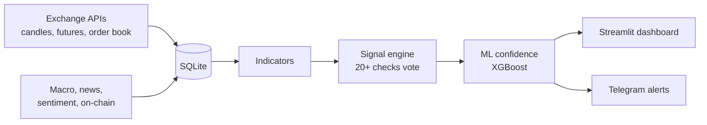
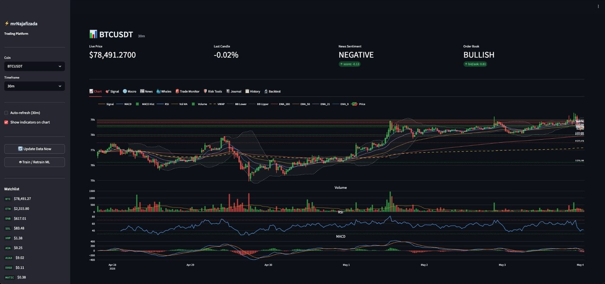
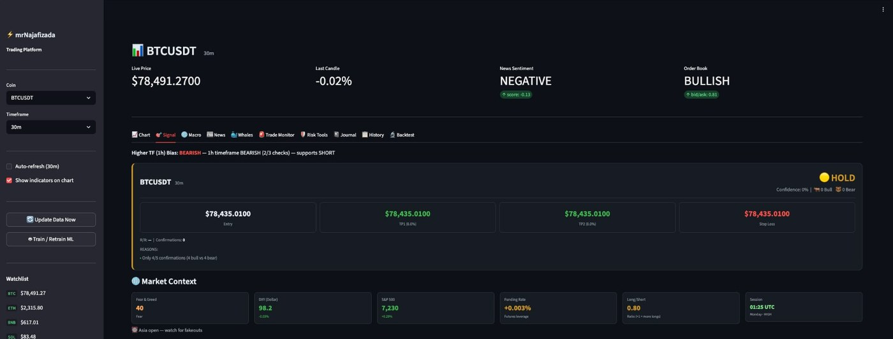
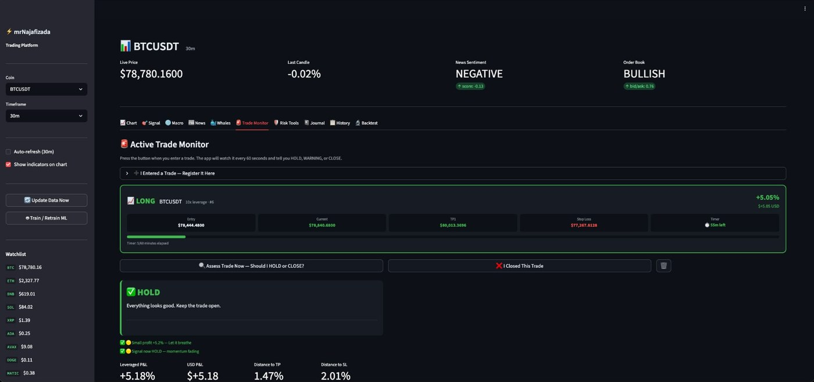

# mrNajafizada Trading Platform

**My first crypto trading system: a local signal platform that grew into a long-only paper-trading bot, and taught me
what a trading system really needs.**

This repository is a **showcase**. The source code is private. What is here explains what the system did, how it was
built, what went wrong, and what I learned. That learning became my second system,
[QuantitativeTrading](https://github.com/Sayed1250/quantitativetrading-showcase).

> Built by **Merwaice Najafizada** (QA engineer) over about a year, 2025–2026, with AI coding assistants under my direction
> and review.

---

## Stage 1: a local signal platform

A crypto trading assistant that runs entirely on your own machine, with no subscriptions.

- **A multi-source signal engine.** Over 20 independent checks vote on each signal (trend, momentum, volume, market
  structure, candlestick patterns, divergences, macro data, futures data, news and community sentiment, on-chain activity),
  and each signal comes with its reasons.
- **Machine learning:** an XGBoost classifier trained walk-forward on historical candles, so it never sees the future.
- **Macro and sentiment:** the Fear & Greed Index, the dollar index, the S&P 500, Bitcoin dominance, 13 news feeds with
  sentiment scoring, and community sentiment.
- **Whale tracking:** large trades, order-book walls and exchange flows, from public data.
- **Risk tools:** a liquidation calculator, a position sizer, a daily loss limit, correlation warnings and trailing-stop
  guidance.
- **A trade monitor:** live profit and loss on open trades, with HOLD / WARNING / CLOSE assessments.
- **A Streamlit dashboard** (10 tabs) and **Telegram** alerts.

### Screenshots

**Chart:** candles with EMAs, Bollinger Bands, VWAP, support and resistance levels, volume, RSI and MACD

**Signal:** the vote of every check, entry, take-profit and stop levels, the higher-timeframe bias and the market context

**Trade monitor:** a registered trade with live profit and loss, distance to target and stop, a timer, and a HOLD / CLOSE assessment

## Stage 2: a long-only paper-trading bot

The platform then became an automated **long-only paper-trading bot** for spot and perpetual futures:

1. Keeps validated candle history for an approved set of coins.
2. Builds one consistent multi-timeframe picture of structure, support and resistance, liquidity and major levels.
3. Recognises defined setup families and tracks each setup's **lifecycle** over time.
4. Waits for real confirmation, defence or retest before acting.
5. Builds entry, stop and target geometry from current inputs.
6. Applies account, portfolio, duplicate-entry and permission rules before any simulated position opens.
7. Supervises open positions (partial exits, stops, runners) against an authoritative account ledger.
8. Explains every opportunity, wait, refusal and outcome on Telegram and an optional dashboard.

**Scale:** about 520 Python modules and about 270 test files, scheduled scans across six timeframes, and one SQLite
database for market data, the paper ledger and every decision.

## What went wrong, and what it taught me

### The database that doubled in a month
The single database grew from **44 GB to 86 GB in one month**, and scans slowed to about 20 seconds per coin.

**Investigation.** Everyone assumed the data reader was too slow. Measurements showed the reader took **under a second**
for the whole watchlist. The real cause: setups that had already **ended** (invalidated, expired, missed) were loaded,
re-evaluated and written again **on every scan**. About **94% of the decision table** was repeated writes of finished
setups. A filter meant to skip identical rewrites leaked whenever live data made a finished setup's labels flicker.

**Fix plan.** Freeze a setup once it ends and remove it from the active scan. That fixes the growth and the speed in one
change. Then remove the repeated rows, keeping each setup's history up to its first final row, but only after a verified
backup, by copying to a new database instead of rewriting in place.

**Lesson:** measure before you optimise. The "obvious" bottleneck was innocent.

### Complexity that stopped trading
With many interacting gates, the bot could go weeks without opening a position, and it was hard to say which rule was
responsible.

**Lesson:** every rule must be **measurable on its own**. If you can't replay a decision and explain it, you can't trust
it with money.

### Safety rules that worked
Some ideas from this bot carried straight into the next one:
- **Paper by default**, with live permission as a separate, explicit act by the owner, never inferred from a branch name,
  a document or a passing test.
- **Never rewrite the ledger** to make something pass. Fix forward and keep the evidence.
- **Back up before any destructive database operation.**
- **One problem at a time:** state the failure, find the responsible function, make the smallest fix, test it and its
  interactions, then move on.

## From here to QuantitativeTrading

| This platform | QuantitativeTrading |
|---|---|
| Many signals, a hard-to-explain whole | A few frozen rules, each measured in research |
| One 86 GB database for everything | Small append-only ledgers, one per account |
| Hard to prove a change was harmless | A replay to the cent and byte-identical paired runs on every change |
| Intraday scans | One decision a day, at the close |
| A dashboard for one person | An installer app for a team, with signed updates |
| Leverage up to 10x | 1x, isolated margin |

➡️ **[See QuantitativeTrading](https://github.com/Sayed1250/quantitativetrading-showcase)**

## Technology

Python · SQLite · pandas · XGBoost · Streamlit · Telegram Bot API · Binance and Bybit REST · VADER sentiment · pytest

*Nothing here is financial advice.*
